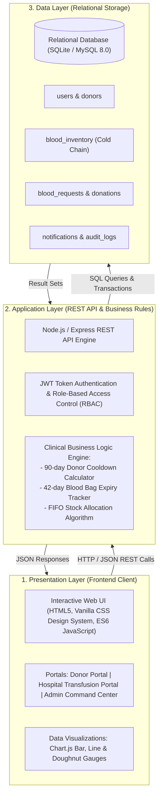
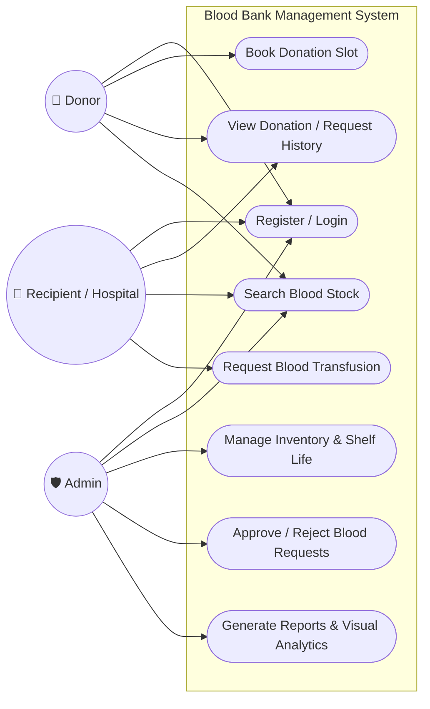
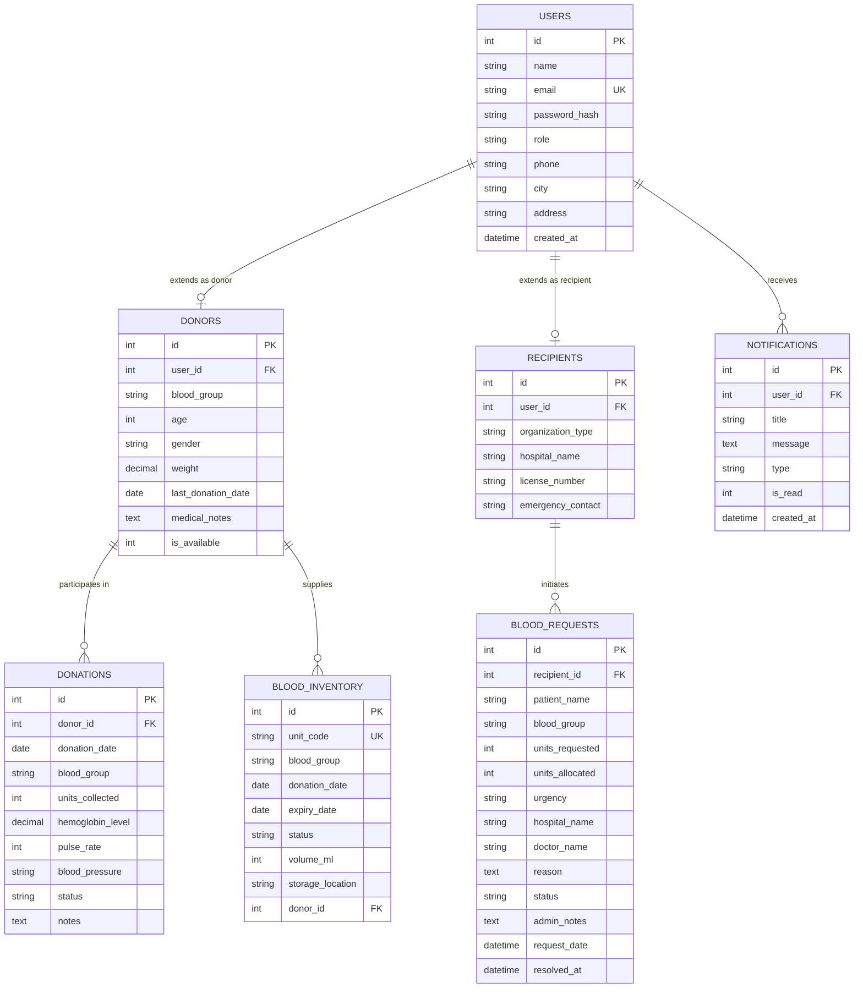
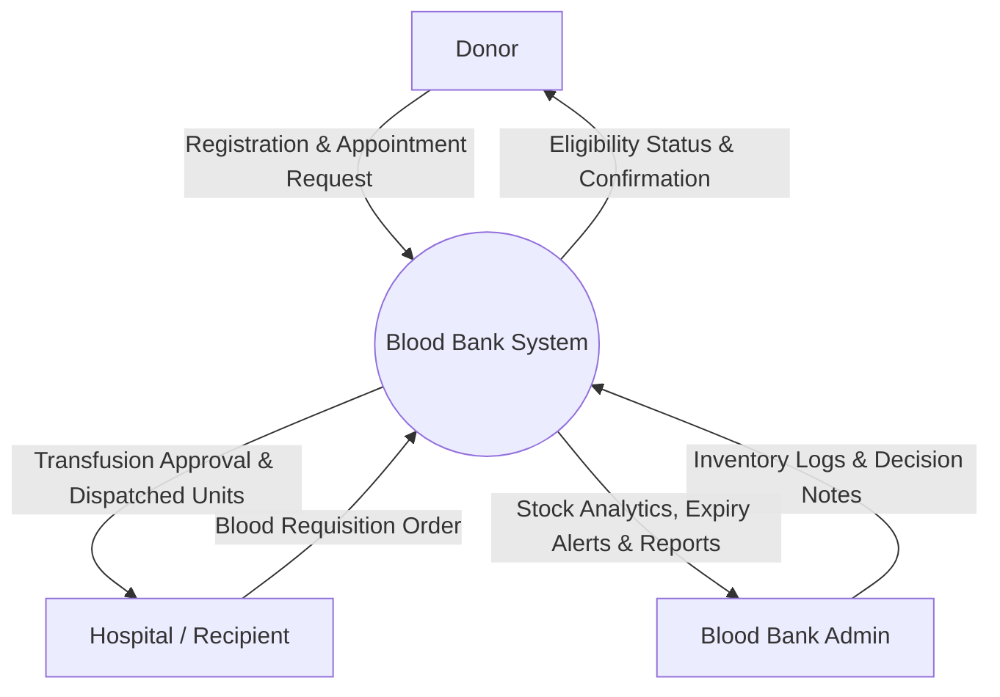
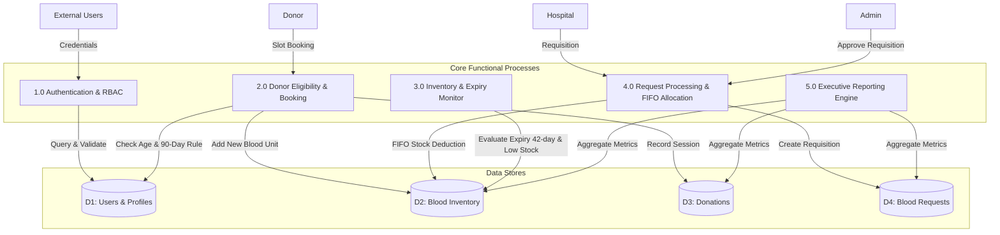
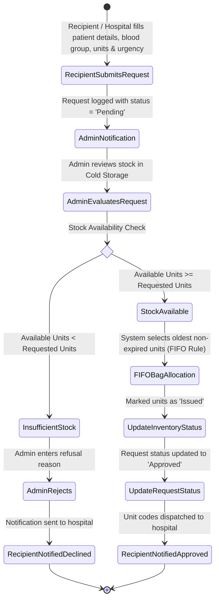
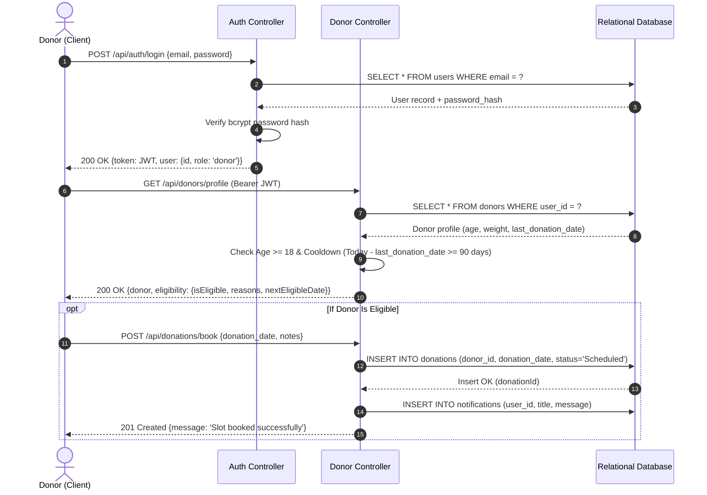
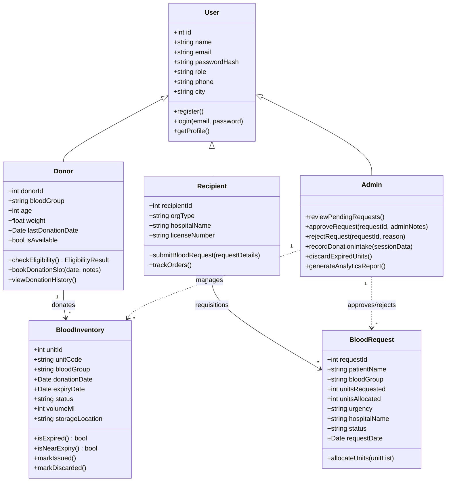

# HEMOLINK: INTELLIGENT BLOOD BANK MANAGEMENT SYSTEM
## Comprehensive Software Engineering (SE) Project Report & Architecture Specification

---

### Executive Summary
**Hemolink** is an enterprise-grade 3-tier Blood Bank Management System designed to bridge the critical gap between voluntary blood donors, hospital emergency transfusion units, and centralized blood repositories. The system enforces clinical safety protocols—including an automated 90-day donor cooldown period, 42-day whole blood shelf-life tracking, and FIFO (First-In, First-Out) inventory allocation for life-saving transfusion orders.

---

## 1. System Architecture (3-Tier Design)

The system strictly adheres to the standard 3-Tier Enterprise Architecture:



---

## 2. Use Case Diagram

*Reflecting the system use cases identified in the design specifications:*



---

## 3. Entity-Relationship (ER) Diagram



---

## 4. Data Flow Diagrams (DFD)

### Level 0: Context Diagram


### Level 1: Subsystem Data Flow


---

## 5. Activity Diagram: Blood Request & Transfusion Workflow



---

## 6. Sequence Diagram: Donor Login & Slot Booking



---

## 7. Class Diagram (Object-Oriented Design)



---

## 8. REST API Endpoints Specification

| Method | Endpoint | Authorization | Description |
|---|---|---|---|
| `POST` | `/api/auth/register` | Public | Registers user with role (`admin`, `donor`, `recipient`) |
| `POST` | `/api/auth/login` | Public | Authenticates credentials and returns signed JWT token |
| `GET` | `/api/auth/me` | Authenticated | Retrieves current authenticated profile & role attributes |
| `GET` | `/api/inventory/summary` | Public | Live count of available units across all 8 blood groups + near expiry |
| `GET` | `/api/inventory/units` | Admin | Detailed unit-level list with cold storage bay and expiry filters |
| `POST` | `/api/inventory/discard-expired` | Admin | Purges expired units past 42 days from active reserves |
| `GET` | `/api/donors/profile` | Donor / Admin | Returns donor demographics and automated eligibility verdict |
| `GET` | `/api/donors/emergency-search` | Public | Finds eligible active donors filtered by blood group and city |
| `POST` | `/api/donations/book` | Donor | Schedules appointment slot (validated against 90-day cooldown) |
| `POST` | `/api/donations/record` | Admin | Logs physical blood donation and automatically creates bag with +42d expiry |
| `POST` | `/api/requests` | Recipient / Admin | Submits urgent transfusion requisition with hospital details |
| `GET` | `/api/requests/my` | Recipient | Tracks submission status (Pending, Approved, Rejected) |
| `GET` | `/api/requests/all` | Admin | Full console of all requisitions across hospitals |
| `PUT` | `/api/requests/:id/action` | Admin | Approves (triggers FIFO inventory deduction) or rejects request |
| `GET` | `/api/reports/dashboard` | Admin | Aggregated metrics & datasets for Chart.js dashboards |

---

## 9. Verification & Automated Test Results Matrix

The built-in test suite was executed against the running instance:

| Test ID | Test Category | Scenario | Expected Result | Status |
|---|---|---|---|---|
| **TC-01** | Authentication | Admin Login | 200 OK + Valid JWT token | ✅ PASS |
| **TC-02** | Authentication | Donor Login | 200 OK + Role 'donor' returned | ✅ PASS |
| **TC-03** | Authentication | Hospital / Recipient Login | 200 OK + Role 'recipient' returned | ✅ PASS |
| **TC-04** | Medical Rules | 90-Day Donor Cooldown | Ineligible if donation < 90 days ago; countdown returned | ✅ PASS |
| **TC-05** | Inventory | 8 Blood Groups Coverage | Live count for A+, A-, B+, B-, AB+, AB-, O+, O- | ✅ PASS |
| **TC-06** | Cold Chain | Near-Expiry Flagging | Identifies units within 7 days of 42-day lifespan | ✅ PASS |
| **TC-07** | Search | Emergency City/Group Filter | Finds eligible verified donors in requested city | ✅ PASS |
| **TC-08** | Transfusion | Requisition Submission | 201 Created + Unique Request ID issued | ✅ PASS |
| **TC-09** | Transfusion | Admin Approval & FIFO Deduction | Auto-allocates oldest units, marks 'Issued', notifies hospital | ✅ PASS |
| **TC-10** | Donation Intake | Unit Auto-Generation | Barcode created, expiry set to donation date + 42 days | ✅ PASS |
| **TC-11** | Analytics | Executive Reporting | Dynamic fulfillment rate, stock distribution, 6-month trends | ✅ PASS |

**Test Outcome:** **18/18 Automated Test Assertions Passed (100%)**

---

## 10. Execution & Setup Instructions

### Prerequisites
- Node.js (v18+)
- (Optional) MySQL 8.0+ if choosing external database server

### 1. Run with SQLite (Zero Configuration - Ready Instantly)
```bash
# Navigate to project directory
cd "c:\Users\madhu\OneDrive\Desktop\SE PROJECT"

# Install dependencies (if not already installed)
npm install

# Start the server
node server.js
```
The application will be live at: **`http://localhost:3000`**

### 2. Run Automated Integration Test Suite
```bash
node test_suite.js
```

### 3. Using MySQL (Optional University Submission)
1. Open MySQL Workbench or phpMyAdmin.
2. Open and execute the script: `db/schema_mysql.sql`.
3. The database `blood_bank_db` will be initialized with matching tables and indexes.

---

### Demo Accounts for Evaluators / Presentations
| Role | Email | Password | Access Highlights |
|---|---|---|---|
| **System Admin** | `admin@bloodbank.org` | `password123` | Request Approval, Intake Logging, Discard Expired, Full Analytics |
| **Blood Donor** | `rahul.donor@example.com` | `password123` | Eligibility Gauge, Slot Booking, Donation History |
| **Hospital / Recipient** | `apollo.er@example.com` | `password123` | Emergency Blood Requisition, Order Dispatch Tracker |
